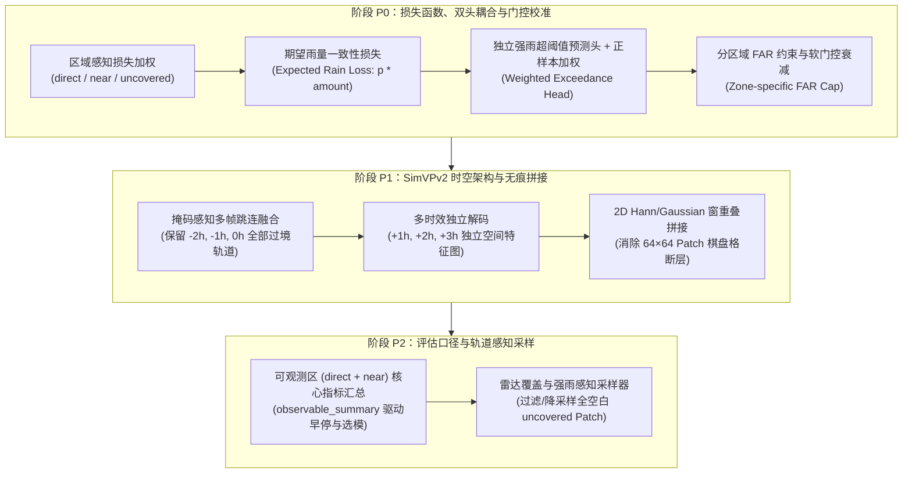

# FY3G_GPM_V2 模型训练与评估改进计划

基于对三次历史实验（`gpm_surface_v1`、`gpm_surface_lr1e4_earlystop`、`gpm_surface_fixed_weights_short_schedule`）及可视化结果的诊断，本计划在不改变底层数据集契约（`fy3ggpm_surface_3h_l1only_0p1_v3`）的前提下，分三个阶段解决**未覆盖区梯度污染、双头解耦导致 MAE 翻倍、+1h~+3h 预测场空间冻结、64×64 拼接断层、以及评估选模口径失真**五大核心问题。

---

## 一、 阶段 P0：损失函数、双头耦合与门控机制重构

> [!IMPORTANT]
> **核心目标**：解决 Run 3 强雨提权后 `amount_head` 全面膨胀、与二分类门控脱节导致 `uncovered` 区出现大面积 `1–5 mm/h` 蓝色虚警毯及 `MAE` 翻倍的问题，同时消除占全图 72% 的 `uncovered` 盲猜区对训练梯度的污染。

### 1.1 引入覆盖区空间损失权重（Zone-aware Loss Masking）
* **涉及文件**：
  * [`losses/gpm_loss.py`](file:///E:/2026Code/FY3G_GPM_V2/losses/gpm_loss.py)
  * [`utils/config.py`](file:///E:/2026Code/FY3G_GPM_V2/utils/config.py)
* **修改内容**：
  1. 在 `TrainConfig` 中新增配置项 `zone_loss_weights: list[float] = [1.0, 0.7, 0.05]`（分别对应 `direct`, `near`, `uncovered`）。
  2. 在 `ThreeHourStrongRainLoss.forward` 中读取 `outputs["coverage_zone"]`（形状 `[B, 64, 64]`，取值 `0, 1, 2`），构建像素级空间权重矩阵 $W_{\text{zone}}$。
  3. 将各项子损失的掩码均值计算升级为支持传入连续空间权重 $W_{\text{zone}}$，大幅压低 `uncovered` 盲猜区域的梯度占比。

### 1.2 增加双头耦合的“期望雨量损失”（Expected Rain Rate Loss）
* **涉及文件**：
  * [`losses/gpm_loss.py`](file:///E:/2026Code/FY3G_GPM_V2/losses/gpm_loss.py)
  * [`utils/config.py`](file:///E:/2026Code/FY3G_GPM_V2/utils/config.py)
* **修改内容**：
  1. 在 `ThreeHourStrongRainLoss.forward` 中加入期望雨量监督：
     * 定义软门控期望对数雨强：$\hat{y}_{\text{expected\_log}} = p_{\text{occ}} \cdot \text{amount\_log}$。
     * 在全有效像素 `valid` 上计算 $\hat{y}_{\text{expected\_log}}$ 与真实 $\log(1 + y)$ 的 Smooth L1 损失（配置项 `expected_amount_weight: float = 0.25`）。
  2. 将无雨区抑制项 `dry_amount_loss` 改为**概率加权惩罚**：重点惩罚那些发生概率 $p$ 较高但实际无雨的假阳性像素上的雨强膨胀。

### 1.3 独立强雨超阈值预测头（Exceedance Head）与正样本平衡
* **涉及文件**：
  * [`models/precipitation.py`](file:///E:/2026Code/FY3G_GPM_V2/models/precipitation.py)
  * [`losses/gpm_loss.py`](file:///E:/2026Code/FY3G_GPM_V2/losses/gpm_loss.py)
* **修改内容**：
  1. 在 `PrecipitationModel` 中废除硬编码公式，改为轻量独立卷积预测头或可学习残差分支。
  2. 在 `ThreeHourStrongRainLoss` 中，为 `5/10/20 mm/h` 各档位引入正样本加权 `exceed_pos_weight`，消除未加权 BCE 对高雨强预测的反向压制。

### 1.4 分区域差异化 FAR 阈值约束（Zone-specific FAR Cap）
* **涉及文件**：
  * [`metrics/thresholds.py`](file:///E:/2026Code/FY3G_GPM_V2/metrics/thresholds.py)
  * [`utils/config.py`](file:///E:/2026Code/FY3G_GPM_V2/utils/config.py)
* **修改内容**：
  1. 在 `ZoneThresholdSearch` 中支持按 `(direct, near, uncovered)` 传入分区域的虚警率上限（如 `[0.75, 0.70, 0.55]`）。
  2. 防止阈值搜索器在 `uncovered` 区为了微弱的 `CSI@0.1` 增益而过度放宽概率阈值。

---

## 二、 阶段 P1：`SimVPv2` 时空架构升级与大网格无痕拼接

> [!IMPORTANT]
> **核心目标**：修复 `SimVPv2` 丢弃 `-2h/-1h` 过境雷达轨道跳连以及 `+1h/+2h/+3h` 共用单帧空间特征导致雨带无法移动的缺陷；消除大图推理中的 `64×64` 矩形拼接断层。

### 2.1 多帧有效掩码感知跳连 + 多时效独立解码
* **涉及文件**：
  * [`models/SimVPv2.py`](file:///E:/2026Code/FY3G_GPM_V2/models/SimVPv2.py)
  * [`models/precipitation.py`](file:///E:/2026Code/FY3G_GPM_V2/models/precipitation.py)
* **修改内容**：
  1. **保留全部 3 个输入时次的跳连信息**：新增跳连融合层，将 `t = -2h, -1h, 0h` 三个输入帧的高分辨率编码特征全部融合并映射到对应的预报时效，避免前序过境雷达回波丢失。
  2. **3 个预报时效各自独立解码**：保留全部 `forecast_leads = 3` 个时效维度并在解码器中并行解码出独立的特征图，使不同预报时效能够学习平流位移（Advection）。

### 2.2 二维汉宁窗 / 高斯窗重叠网格无痕拼接（Windowed Grid Blending）
* **涉及文件**：
  * [`trainers/evaluation.py`](file:///E:/2026Code/FY3G_GPM_V2/trainers/evaluation.py)
  * [`scripts/finalize.py`](file:///E:/2026Code/FY3G_GPM_V2/scripts/finalize.py)
* **修改内容**：
  1. 引入 2D raised-cosine / Hann 窗函数进行 Patch 边缘平滑加权。
  2. 在 `for_each_deduplicated_grid` 中对重叠预测区域进行权重累加归一化，彻底消除方格拼接断层。

---

## 三、 阶段 P2：评估体系升级与有效轨道感知采样

> [!IMPORTANT]
> **核心目标**：让早停（Early Stopping）与模型选择聚焦于物理可观测区（`direct + near`），并通过过滤全空白无效 Patch 提升训练信噪比与速度。

### 3.1 新增 `observable_summary` 与 `pooled_summary` 评估汇总
* **涉及文件**：
  * [`metrics/gpm_metrics.py`](file:///E:/2026Code/FY3G_GPM_V2/metrics/gpm_metrics.py)
  * [`trainers/gpm_trainer.py`](file:///E:/2026Code/FY3G_GPM_V2/trainers/gpm_trainer.py)
  * [`utils/config.py`](file:///E:/2026Code/FY3G_GPM_V2/utils/config.py)
* **修改内容**：
  1. 在 `GridMetrics.finish` 中新增 `observable_summary`（仅统计 `direct + near` 区）和 `pooled_summary`。
  2. 允许将早停和 `best_csi_*` 检查点依据 `observable_summary` 进行选模。

### 3.2 轨道与降水感知的训练集采样器（Coverage-aware Sampler）
* **涉及文件**：
  * [`datasets/samplers.py`](file:///E:/2026Code/FY3G_GPM_V2/datasets/samplers.py)
  * [`trainers/gpm_pipeline.py`](file:///E:/2026Code/FY3G_GPM_V2/trainers/gpm_pipeline.py)
  * [`utils/config.py`](file:///E:/2026Code/FY3G_GPM_V2/utils/config.py)
* **修改内容**：
  1. 在 `ForecastTimeRoundRobinBatchSampler` 中支持对完全无雷达覆盖且无降水的纯背景 Patch 进行下采样（如 `uncovered_patch_keep_ratio: float = 0.25`）。
  2. 提升有效雷达轨道样本的训练信噪比与迭代速度。
