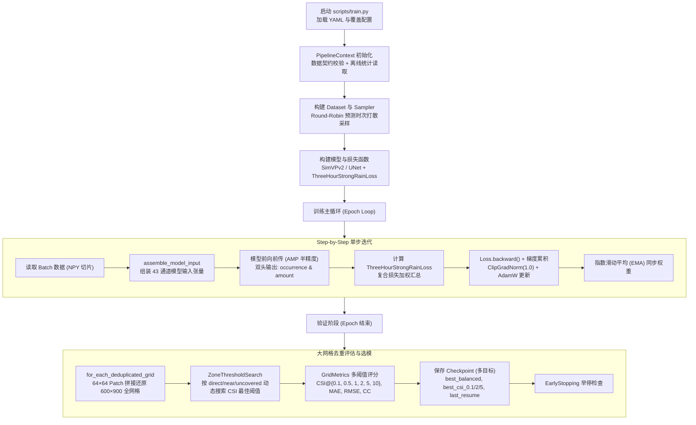

# FY3G_GPM_V2 训练流程与复合损失函数（Loss）深度解析

本文档全面梳理本项目当前模型的**端到端训练流程**，并重点对核心损失函数 **[`ThreeHourStrongRainLoss`](file:///E:/2026Code/FY3G_GPM_V2/losses/gpm_loss.py)** 的数学构造、代码实现、设计意图以及存在的梯度博弈进行深度拆解。

---

## 一、 端到端训练流程概览

整个训练流程由 [`scripts/train.py`](file:///E:/2026Code/FY3G_GPM_V2/scripts/train.py) 驱动，经过管线上下文初始化、数据构建、前向推理、梯度更新、大网格去重验证到多目标检查点保存：



### 1.1 数据组装与输入契约
每个训练样本由 [`assemble_model_input`](file:///E:/2026Code/FY3G_GPM_V2/datasets/gpm_inputs.py#L7-L32) 组装为 **43 通道** 的 5 维张量 `[Batch, 3, 43, 64, 64]`：
- **20 通道反射率**：Ku 与 Ka 双波段各 10 个离地高度层（2–11 km），在 `x_valid` 有效区域按训练集均值方差标准化，无效区域置 `0`。
- **20 通道有效掩码**：对应上述反射率的布尔掩码（0 或 1）。
- **2 通道地理坐标**：经度、纬度归一化特征。
- **1 通道轨道方向**：卫星升降轨标识。

### 1.2 模型输出契约（双头架构）
模型解码后分别通过两个 `1×1` 卷积输出：
1. **发生率头 `occurrence_head`**：输出 Logits，经过 Sigmoid 得到二分类降水概率 $p \in [0, 1]$。
2. **强度回归头 `amount_head`**：输出标准化对数雨强，经反标准化和 $\exp(x)-1$ 得到连续降水率预测值（mm/h）。

---

## 二、 重点关注：复合损失函数（ThreeHourStrongRainLoss）

损失函数定义在 [`losses/gpm_loss.py`](file:///E:/2026Code/FY3G_GPM_V2/losses/gpm_loss.py) 中，由 **分类（Occurrence）**、**回归（Amount）** 和 **强雨超阈值（Exceedance）** 三大子系统复合而成：

$$\mathcal{L}_{\text{total}} = \mathcal{L}_{\text{occurrence}} + \mathcal{L}_{\text{amount}} + \lambda_{\text{exceed}} \cdot \mathcal{L}_{\text{exceed}}$$

各子损失项在默认配置下的权重与构成如下表所示：

| 损失项名称 | 代码变量 | 默认权重 / 比例 | 作用区域 | 核心数学思想与设计目的 |
| :--- | :--- | :--- | :--- | :--- |
| **加权 Focal Loss** | `focal_loss` | 1.0 | 全有效像素 | 解决无雨像素占 95%+ 的极度不平衡，压制易分负样本 |
| **多尺度 Soft-CSI** | `csi_loss` | 0.25 | 全有效像素 | 1x, 2x, 4x 多尺度可微 CSI 逼近，直接优化气象核心指标 |
| **邻域 FSS 损失** | `neighborhood_fss_loss` | 0.10 | 全有效像素 | 3x3 与 5x5 邻域分数技巧评分，容忍微小空间平移误差 |
| **校准 BCE 损失** | `calibration_bce_loss` | 0.02 | 全有效像素 | 未加权的普通二值交叉熵，防止概率 Logits 发生严重漂移 |
| **难负样本挖掘** | `hard_negative_loss` | 0.02 (按 Epoch 渐增) | 晴空无雨区 | 挑选 BCE 误差最大的前 2% 假阳性无雨像素重点反传 |
| **强雨加权 Smooth L1** | `rain_amount_loss` | 1.0 | 真实有雨像素 ($y \ge 0.1$) | 频次倒数平方根加权 + 二次方强雨放大，迫使网络关注极值 |
| **晴空抑制损失** | `dry_amount_loss` | 0.05 | 真实无雨区 ($y < 0.1$) | 惩罚无雨区未门控雨强 $\hat{y}$ 的正偏离，抑制全图虚警雨量 |
| **强雨超阈值损失** | `exceedance_loss` | 0.20 | 全有效像素 | 针对 5, 10, 20 mm/h 设立阶梯式软超阈值惩罚 |

---

### 2.1 降水发生率分类损失：$\mathcal{L}_{\text{occurrence}}$

降水二分类的最大痛点是**类别极度不平衡**（晴空占比超过 95%）。分类损失通过组合五种互补算子解决：

$$\mathcal{L}_{\text{occurrence}} = w_{\text{focal}}\mathcal{L}_{\text{focal}} + w_{\text{csi}}\mathcal{L}_{\text{soft\_csi}} + w_{\text{fss}}\mathcal{L}_{\text{fss}} + w_{\text{calib}}\mathcal{L}_{\text{bce}} + w_{\text{hard}}\mathcal{L}_{\text{hard}}$$

#### (1) 带正样本权重的 Focal Loss
```python
bce = F.binary_cross_entropy_with_logits(logits, rainy.float(), pos_weight=self.positive_weight)
focal = (1 - torch.where(rainy, probability, 1 - probability)).pow(self.focal_gamma) * bce
```
- **正样本加权**：`pos_weight` 取 $\min\left(20, \sqrt{\frac{N_{\text{dry}}}{N_{\text{rain}}}}\right)$，将正样本（降水）损失放大数倍。
- **调制因子**：$(1 - p_t)^\gamma$（$\gamma = 2.0$），对于已经很有把握的晴空背景（$p \approx 0$），权重趋近于 0，迫使梯度集中在分类模糊的边界区域。

#### (2) 多尺度 Soft-CSI 损失（可微 CSI）
CSI 指标不可导，代码采用软集合交并比构建平滑替代：
$$\text{Soft-CSI} = \frac{\sum p \cdot y + 1}{\sum (p + y - p \cdot y) + 1}, \quad \mathcal{L}_{\text{csi}} = 1 - \text{Soft-CSI}$$
并在 **1×1（权重0.60）、2×2（权重0.25）、4×4（权重0.15）** 三个平均池化尺度上联合计算，既强调点对点精度，又允许次网格尺度平滑容错。

#### (3) 邻域分数技巧评分损失（FSS Loss）
气象预报中存在“双重惩罚”问题（预报雨团只要偏移 1 个像元，点对点评分就会同时记一次假阳性和一次漏报）。FSS 引入 3×3 与 5×5 空间均值平滑：
$$\text{FSS} = 1 - \frac{\sum (\bar{p}_w - \bar{y}_w)^2}{\sum (\bar{p}_w^2 + \bar{y}_w^2) + \epsilon}$$
引导模型学习合理的空间降水形态与范围。

#### (4) 动态退火难负样本挖掘（Hard Negative Mining）
在训练中后期（Epoch 21 到 60 逐渐生效），对晴空无雨区中误差最高的前 **2% 虚警像素** 施加针对性惩罚，专门用于削减大范围虚警。

---

### 2.2 降水强度回归损失：$\mathcal{L}_{\text{amount}}$

降水强度数值服从极度长尾分布（小雨极多，大暴雨极少）。回归损失的核心是**对数空间变换**与**样本频次倒数动态加权**：

```python
target_normalized = (torch.log1p(target) - mean) / std
regression = F.smooth_l1_loss(normalized, target_normalized, reduction="none")
weight, rain_mask = self._regression_weights(target, rainy)
rain_amount = self._mean(regression * weight, rain_mask)
dry = self._mean(amount_log.clamp_min(0).square(), valid & ~rainy)
amount = 1.0 * rain_amount + 0.05 * dry
```

#### (1) 强度区间频次动态加权（`_regression_weights`）
- 将真实降水按阈值划分为 11 个雨强区间（0.1, 0.5, 1, 2, 5, 10, 20, 40... mm/h）。
- 每个区间的基础权重 $w_{\text{group}}$ 由频次倒数平方根生成：
  $$w_{\text{raw}} = \sqrt{\frac{N_{\text{total\_rain}}}{N_{\text{bin}} + 10}}$$
- **二次极值放大**：
  $$w = w_{\text{group}} \cdot \left(1 + \left(\frac{y}{q_{90}}\right)^2\right)$$
  将权重截断在 `[0.1, 10.0]` 之间。对超过 90% 分位数的强降水给予高达 10 倍的梯度拉力，彻底打破传统 MSE 导致的强对流预测“严重削峰”现象。

#### (2) 晴空无雨区惩罚（`dry_amount_loss`）
只在 $y < 0.1$ 的干区计算 $\hat{y}_{\text{log}}^2$，权重为 `0.05`。其作用是防止回归头在无雨区毫无约束地发散。

---

### 2.3 强降水超阈值辅助损失：$\mathcal{L}_{\text{exceed}}$

为了进一步强化强雨的跃升特征，模型硬编码了三档对数概率超阈值 logits：
$$\text{logit}_k = 4.0 \cdot \left(\log(1+\hat{y}) - \log(1+T_k)\right), \quad T_k \in \{5.0, 10.0, 20.0\}\text{ mm/h}$$
并对其真实标签（是否超过 $T_k$）进行 BCE 监督。权重分别分配为 0.40（5 mm/h）、0.35（10 mm/h）、0.25（20 mm/h）。

---

## 三、 当前 Loss 的设计亮点与现存关键矛盾

### 3.1 设计亮点
1. **气象专业指标深度融入反向传播**：将业务评测最核心的 CSI、FSS 转化为连续可微损失，避免传统只优化 L1/L2 导致的“模糊平滑预测”。
2. **多尺度与长尾频次精细化设计**：解决了降水场中大范围弱雨与局部极端对流并存时的尺度与数值失衡。

### 3.2 训练中暴露出的核心痛点（待优化点）
1. **未覆盖区无差别计算 Loss 带来梯度污染**：
   - 占验证集 **71.89%** 的 `uncovered` 区域没有任何雷达观测输入（仅有静态经纬度）。
   - 当前 Loss 在整个 `valid` 掩码上均等平均，导致 **70% 以上的梯度来自对未覆盖区的“瞎猜”**，迫使网络过早拟合经纬度气候态。
2. **双头解耦与门控阈值的博弈失衡**：
   - `amount_head` 在强雨提权后输出偏大，而门控阈值搜索仅看 `CSI@0.1`；在虚警率较高的未覆盖区，低阈值打开后直接喷涌出 $1\sim 3\text{ mm/h}$ 的雨强，导致全图 MAE 翻倍。
3. **超阈值 BCE 缺乏正样本加权产生反向压制**：
   - `exceedance_loss` 使用了未加权的 BCE，由于 5/10/20 mm/h 真实正样本极少，BCE 实际上大部分时间在把高雨强预测往下拉，与强雨回归权重产生内耗。
