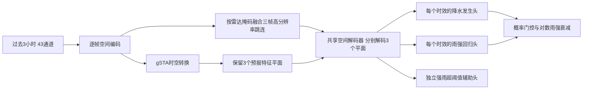

# 区域感知、多时效降水训练流程

本说明对应 `configs/gpm_surface_v4.yaml`。旧 YAML 不设置新增选项时，仍采用旧单帧解码、硬门控、均匀拼接和全区域宏平均选模，以便继续评估旧 checkpoint。

## 数据如何进入训练

项目消费 `fy3ggpm_surface_3h_l1only_0p1_v3` 成品数据，不读取原始 FY-3G/GPM HDF，也不读取处理阶段的 cache。服务器配置根目录为 `/lixj/pyx/dataset/FY3G_after`，本地可通过 `--data-root G:\FY3G_after` 覆盖。

启动时检查 `source_manifest.json`、数据版本、网格与统计量。`FY3G3HDataset` 根据 split 和 shard 清单使用 mmap 按样本读取以下文件：

| 文件 | 单样本形状 | 用途 |
| --- | --- | --- |
| `x_reflectivity.npy` | `[3,2,10,64,64]` | 过去三个小时的 Ku/Ka、2–11 km 共 20 层反射率 |
| `x_valid.npy` | `[3,2,10,64,64]` | 对应雷达有效性掩码 |
| `x_geo.npy` | `[3,2,64,64]` | 已处理的纬度、经度特征 |
| `x_direction.npy` | `[3,64,64]` | 升降轨方向特征 |
| `y_amount.npy` | `[3,1,64,64]` | 未来 +1/+2/+3 小时 GPM 地表雨强真值，mm/h |
| `y_valid.npy` | `[3,1,64,64]` | 哪些目标像元参与损失和评估 |

前四类是模型输入，后两类是监督信号，并非六类文件都拼入网络。`metadata.jsonl` 提供预报时刻、patch 网格位置和覆盖比例，不作为额外网络通道。

`datasets/gpm_inputs.py` 使用训练集的 `statistics/input_statistics.json` 标准化各反射率层，无效雷达填 0，再拼接：20 个反射率通道 + 20 个有效性通道 + 2 个坐标通道 + 1 个方向通道。最终输入为 `[B,3,43,64,64]`。目标的对数均值、标准差、分档频数、强雨正例数来自 `statistics/target_statistics.json`；验证集和测试集不重新计算这些统计量。

## 一个 epoch 怎样抽样

`ForecastTimeRoundRobinBatchSampler` 按预报时刻轮转，尽量避免一个 batch 全来自同一时刻。

新配置 `uncovered_patch_keep_ratio: 0.25` 只对训练集启用。启动时先通过三个输入时次的 `input_valid_fraction` 找到完全没有雷达覆盖的候选 patch，再只读取候选所在 shard 的 `y_amount/y_valid`，确认是否存在有效的 `>=0.1 mm/h` 降水。覆盖信息缺失、无有效目标、有效目标出现非有限值的样本保守保留。存在雷达覆盖或任一预报时效有雨的 patch 全部保留；其余纯背景每轮保留四分之一（向上取整）。

每轮按 `seed + epoch * 1009` 确定抽样和顺序，同一 epoch 可复现，选中样本不重复。未抽中的背景会在后续 epoch 有机会被选中；训练集没有被物理删除。验证、测试和训练诊断子集均保持完整 patch，不使用此过滤。首次训练启动增加一次目标扫描；旧配置 keep ratio 为 1 时跳过扫描。

本次只读核验 `G:\FY3G_after` 的 77,579 个训练 patch，符合上述严格条件的纯背景候选为 0，因此这份数据每轮仍保留 77,579 个样本。保留比例设为 0.25 不代表会丢弃全体训练集的 75%；实际缩减取决于符合条件的背景样本数，当前数据不能靠此项获得预期的采样加速。

## 模型怎样预测三个小时



新配置 `simvpv2_multi_lead: true` 保留三个时效的潜在特征，并行通过共享 decoder；不是复制一张最终预测图。高分辨率 skip 将过去三个时次的编码特征按各自雷达有效掩码过滤后，经 1×1 卷积融合为三个时效的 skip。每个时效用自身特征和自身输出头参数预测。

- 发生头：logits 经 sigmoid 得到降水概率 `p`，形状 `[B,3,1,64,64]`。
- 雨强头：预测标准化的对数雨强，使用训练统计量反变换为 `amount_log`，限制在 `[0,log(301)]`；`ungated_amount=expm1(amount_log)`，范围 0–300 mm/h。
- 独立强雨头：预测超过 5/10/20 mm/h 的 logits，形状 `[B,3,1,3,64,64]`。它参与辅助 BCE 训练，不直接替代最终雨强，也不直接决定发生头阈值。

默认宽度配置下新版约 96.7 万参数；U-Net 的 3000–4000 万参数要求不适用于 SimVPv2。三时效 decoder 增加计算量和激活显存，不能仅凭采样减少推断每轮必然加速。

## 损失与区域约束

先从三个输入时次的有效掩码计算区域：任一有效雷达像元是 `direct`；在 9×9 邻域扩张内但非 direct 的像元是 `near`；其余为 `uncovered`。新配置区域权重分别为 `[1.0,0.7,0.05]`。损失除以原有效像元数，而非区域权重之和，因此即使整个 batch 都是 uncovered，其梯度也确实受到衰减。

| 损失项 | 新配置系数 | 作用 |
| --- | --- | --- |
| Focal BCE | 1.0 | 有雨/无雨分类，并平衡正负样本 |
| 多尺度 Soft CSI | 0.25 | 改善检出和虚警的整体平衡 |
| 邻域 FSS | 0.10 | 约束邻域降水空间分布 |
| 校准 BCE | 0.02 | 约束发生概率 |
| 有雨区雨强 Smooth L1 | 1.0 | 监督标准化对数雨强，含分档频率与强度权重 |
| 无雨区雨强惩罚 | 0.05 | 惩罚 `p.detach() * amount_log²`，重点压制高概率虚警处的雨强 |
| 强雨超阈值 BCE | 0.20 | 学习 5/10/20 mm/h；三个阈值权重为 0.40/0.35/0.25 |
| 期望对数雨强 Smooth L1 | 0.25 | 在全部有效目标像元监督 `p * amount_log` 对 `log1p(y)`，同时训练概率头与雨强头 |
| 困难负样本 BCE | 最终 0.02 | 对无雨区困难样本补充惩罚，第 21–25 轮逐步开启 |

`exceed_pos_weight=sqrt(N_neg/N_pos)` 限制在 `[1,25]`，计数取自原训练集统计量。各项使用目标有效掩码，并应用区域权重；未来三个时效权重均为 1。这里的“期望”明确指**概率加权对数雨强**，不是物理雨强的算术期望 `p * amount`。FSS、CSI、区域加权等属于统计学习约束，代码未加入水量守恒、风场或平流方程的硬物理约束。

## 每轮更新、验证和保存

训练使用 AdamW、warmup + cosine 学习率、梯度裁剪和 EMA。新配置 seed=14，最多 25 轮，前 5 轮 warmup，峰值学习率 1e-4，末端 5e-6，micro/effective batch 均为 64，无需梯度累积；若分别配置有效 batch 和 microbatch，则使用累积。CUDA 上使用 bfloat16 autocast，CPU 不启用混合精度。每个 epoch 都有训练与验证进度条。

每轮验证先把同一预报时刻的重叠 patch 拼回 600×900 网格，再搜索三时效、三区域的发生概率阈值，随后计算固定已选阈值下的完整指标。新配置使用二维 Hann 权重窗，中心 1、边界最低 0.05，概率和未门控雨强按权重累加并归一化。真值仍按有效观测次数平均，不做 Hann 加权。验证、测试及 finalize 个例绘图复用同一个拼接函数。

新配置的最终预测为：

```text
rate = expm1(p * log1p(ungated_amount))    if p >= threshold[lead,zone]
       0                                otherwise
```

也就是先按分区域发生概率阈值判定是否放行，再对放行的雨强做概率衰减。`rain_gate_mode: hard` 的旧行为是放行后直接使用 `ungated_amount`。

搜索阈值仅使用验证集，三区 FAR 上限为 `[0.75,0.70,0.55]`。某区域在配置的搜索范围内没有满足 FAR 上限的阈值时，不回退到违反上限的阈值，而是标记 `no_feasible_threshold_abstain`，保存略大于 1 的阈值令该区域不报雨。此时 FAR 无预测事件，记 NaN，不声称达到某个 FAR 分数。旧标量 FAR 配置保留原回退行为。

指标包括降水发生分类 CSI/POD/FAR、最终门控雨强的 MAE/RMSE/CC，以及 0.1/0.5/1/2/5/10 mm/h 的雨强 CSI。分类 CSI 和雨强 CSI@0.1 并不保证相同：概率放行后，最终雨强仍可能低于 0.1 mm/h。

评估同时返回以下口径：

- `summary`：保留旧的全区域宏平均，便于历史结果比较。
- `observable_summary`：direct + near 的有限分组宏平均。
- `direct_summary`：仅 direct 的有限分组宏平均。
- `pooled_summary`：所有有效像元汇总计数后的微平均；MAE/RMSE 按全部有效像元计算，CC 合并中心矩计算，并非平均各组 CC。

新配置 `primary_selection_domain: observable`：早停、`best_balanced_inference.pt` 和 `best_csi_0.1/2/5_inference.pt` 都采用可观测区对应指标；日志明确打印 `Selection domain=observable`，进度条 CSI 也使用此口径。早停以可观测区**分类 CSI** 判断耐心；三个 `best_csi_*` 分别以该区域的物理雨强 CSI 选模。旧配置默认 `macro_all`；也可选择 `direct_only`。不要把新实验 observable CSI 与旧实验全区域 CSI 直接比较。

训练主要输出为 `training.log`、`metrics.json` 和 `checkpoints/`。`metrics.json` 保留原有精简 validation 字段，新增完整六阈值的 observable/pooled/direct 和 selection 汇总；分组及完整损失写入训练日志，完整评估及紧凑历史也在 checkpoint 中。诊断开关启用时，在首轮、每 5 轮及最后一轮计算固定训练子集及 raw/EMA 对照；它不代替每轮验证。不会另写 `history.json` 或 `diagnostic_subset.json`，诊断子集清单随 checkpoint 的 `training_state.diagnostic_audit` 保存。

## 启动和验收

```bash
# 真实数据 CPU 单样本预检
python scripts/preflight.py --config configs/gpm_surface_v4.yaml

# 从头训练；先根据服务器实际位置修改 YAML 的 dataset_root
python scripts/train.py --config configs/gpm_surface_v4.yaml

# 本次实验断点续训，需保留对应目录下的最佳权重
python scripts/train.py --config configs/gpm_surface_v4.yaml --resume outputs/gpm_surface_v4/checkpoints/last_resume.pt

# 最终测试与个例可视化，沿用验证时冻结的阈值
python scripts/finalize.py --config configs/gpm_surface_v4.yaml --cases 3

python run_tests.py
```

输出目录为 `outputs/gpm_surface_v4`。新增 head 和 skip 改变了模型结构，必须从头启动这个新实验；旧实验继续使用其原 YAML 加载旧 checkpoint。恢复训练时会校验模型新增选项、数据 manifest、选模区域、背景保留比例和权重策略，避免混用不同实验分数或结构。

代码验证覆盖新旧配置、实际旧 checkpoint 严格加载、分时效特征、掩码融合、Hann 数值、区域损失梯度、强雨正例权重、严格 FAR 回退、宏/微平均与两轮合成数据训练。真实数据单样本预检不能证明泛化改善；仍需完成新的 25 轮实验，按相同评估口径比较 CSI@0.1/2/5、全图 pooled MAE 和原三个案例。MAE≤0.28、虚警减少及雨带演变改善是实验验收目标，不是代码修改能够保证的结果。Hann 只能缓解重叠 patch 的接缝，不能保证所有空间伪影都消失。
